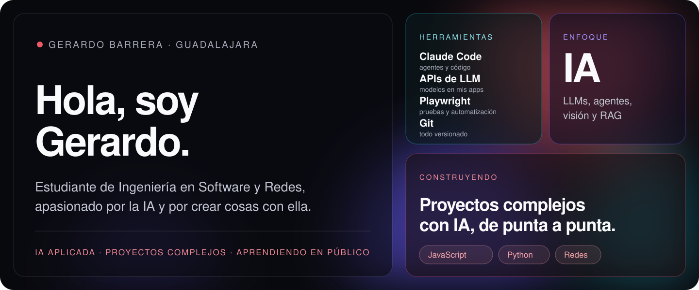
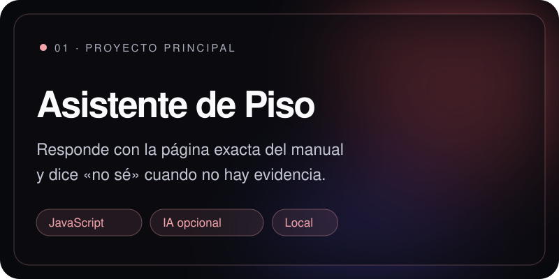
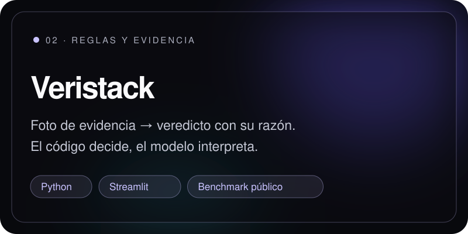
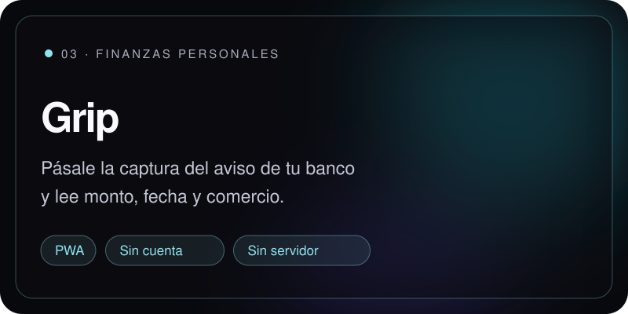
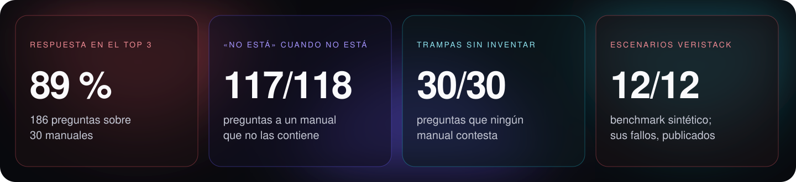

<a href="https://github.com/GERARDOBR01"><picture><source media="(prefers-color-scheme: light)" srcset="assets/perfil-2026/hero-light.svg"></picture></a>

Soy estudiante de **Ingeniería en Software y Redes** y me apasiona el avance de la IA. Mientras fortalezco
mis bases del software, uso la IA a fondo para crear proyectos complejos y herramientas técnicas.
No espero a saberlo todo para empezar: construyo, me equivoco, lo arreglo y de ahí aprendo.
Me importa que lo que hago se pueda abrir, probar y entender. Abierto a oportunidades junior en
desarrollo, automatización o redes. **[LinkedIn](https://www.linkedin.com/in/gerardo-barrera-dev/)**

## Lo que he armado

<a href="https://github.com/GERARDOBR01/Asistente-de-piso"><picture><source media="(prefers-color-scheme: light)" srcset="assets/perfil-2026/asistente-light.svg"></picture></a>

**[Asistente de Piso](https://github.com/GERARDOBR01/Asistente-de-piso)**, mi proyecto más grande: responde dudas leyendo manuales,
cita la página exacta y dice «no sé» en lugar de inventar. Búsqueda local, modo con API opcional y [demo en vivo](https://gerardobr01.github.io/Asistente-de-piso/).

<table><tr><td width="50%" valign="top">
<a href="https://github.com/GERARDOBR01/veristack"><picture><source media="(prefers-color-scheme: light)" srcset="assets/perfil-2026/veristack-light.svg"></picture></a>
<b><a href="https://github.com/GERARDOBR01/veristack">Veristack</a></b>: revisa fotos contra reglas y da un veredicto con su razón. Lo verificable lo decide el código; el modelo solo interpreta.
</td><td width="50%" valign="top">
<a href="https://github.com/GERARDOBR01/Grip"><picture><source media="(prefers-color-scheme: light)" srcset="assets/perfil-2026/grip-light.svg"></picture></a>
<b><a href="https://github.com/GERARDOBR01/Grip">Grip</a></b>: finanzas personales sin cuenta ni servidor. Le pasas la captura del aviso de tu banco y lo lee. <a href="https://gerardobr01.github.io/grip/">Abrirla</a>.
</td></tr></table>

Y más: **[Serie](https://github.com/GERARDOBR01/Grind001)** (entreno, comida y movilidad con test por cámara),
**[Guardadito](https://github.com/GERARDOBR01/CAJITAS-)** (ahorro en pareja con mascota) y
**[CRM Certeza](https://github.com/GERARDOBR01/CRM-CLIENTES-)** (a quién escribirle hoy, con Python y Streamlit).

## Resultados medidos

<picture><source media="(prefers-color-scheme: light)" srcset="assets/perfil-2026/resultados-light.svg"></picture>

Me gusta medir y publicar los límites: cada cifra sale de un benchmark con su método y sus fallos a la vista,
en el [README de Asistente de Piso](https://github.com/GERARDOBR01/Asistente-de-piso#readme) y en los
[resultados de Veristack](https://github.com/GERARDOBR01/veristack/blob/main/benchmark/RESULTADOS.md).
No son una garantía para cualquier caso. Las demos usan datos de ejemplo.

## Novedades

<!--NOVEDADES:INICIO-->
- **Guardadito** · [Lista para Play: capturas nuevas, privacidad al día y Android en el CI (v0.18)](https://github.com/GERARDOBR01/CAJITAS-/commit/9ac871832ac6a0ede7bf4f553f0c3d29e236d1a8) 25 oct
- **Guardadito** · [Cuentas seguras: código de un solo uso, una pareja por persona y nada se pierde (v0.17)](https://github.com/GERARDOBR01/CAJITAS-/commit/7cd0401174d633522194857e0c297059c6c44fd0) 25 oct
- **Serie** · [APK: barras del sistema en modo nativo](https://github.com/GERARDOBR01/Grind001/commit/72b5f7b5521579156425b97e3d7de61229633412) 13 oct
- **Serie** · [Emulador: verificar la interfaz con una señal en el logcat](https://github.com/GERARDOBR01/Grind001/commit/f29fc34c4ef12d44595e1b2de931fd482a33787e) 13 oct
- **Grip** · [Pantallas: reglas, plantillas, estado de cuenta y contra la quincena pasada](https://github.com/GERARDOBR01/Grip/commit/c2973ca75f5bfc6630186e5dc8daa43ad57c0833) 13 oct
<!--NOVEDADES:FIN-->

<b>In English</b>

Hi, I'm Gerardo, a Software and Networks Engineering student in Guadalajara, Mexico, passionate about AI.
I use it heavily to build complex projects and technical tools while I strengthen my software fundamentals.
My biggest project is Asistente de Piso, an app that answers questions from manuals and cites the exact page.
I measure my results and publish their limits. Open to junior opportunities in development, automation or networking.

[LinkedIn](https://www.linkedin.com/in/gerardo-barrera-dev/)

