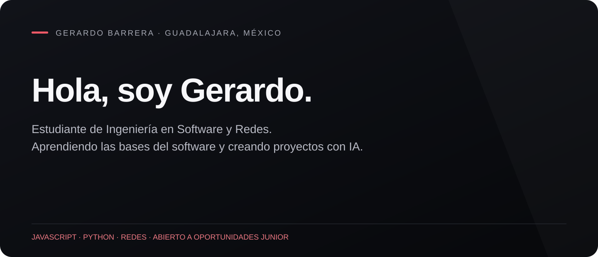
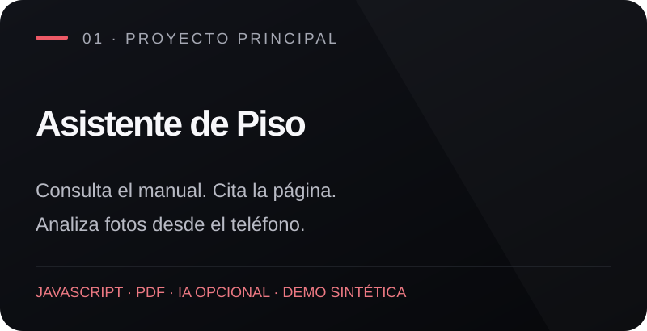
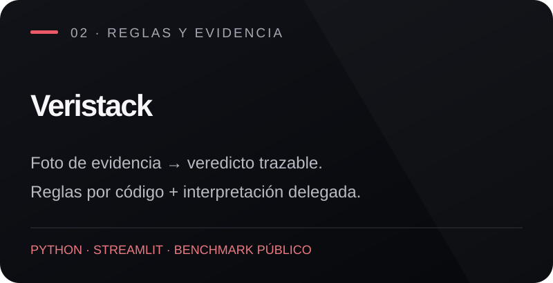
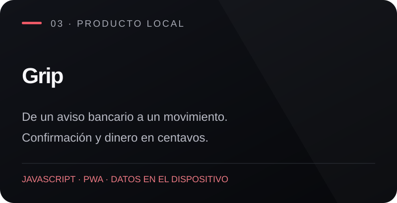

### Hola, soy Gerardo 👋

Soy estudiante de **Ingeniería en Software y Redes** (UVM, Guadalajara). Estoy mejorando mis bases
del software, y mientras tanto uso las herramientas de IA con muchas ganas para crear proyectos y
herramientas técnicas: apps, utilidades, pruebas de ideas y todo lo que se me ocurra que valga la pena armar.

No soy de los que esperan a saberlo todo para empezar. Construyo, me equivoco, lo arreglo y de ahí aprendo.
Me gusta que lo que hago se pueda abrir, probar y entender, no solo que se vea bien.

**[LinkedIn](https://www.linkedin.com/in/gerardo-barrera-dev/)** · estoy abierto a oportunidades junior en desarrollo, automatización o redes.

## Lo que he armado

**[Asistente de Piso](https://github.com/GERARDOBR01/Asistente-de-piso)** es mi proyecto más grande: una app que
responde dudas leyendo manuales y te dice de qué página sacó la respuesta. Si no encuentra nada, dice «no sé» en
lugar de inventar. Funciona desde el celular, con búsqueda local y un modo con API opcional.
[Probarla aquí](https://gerardobr01.github.io/Asistente-de-piso/).

<table><tr><td width="50%" valign="top">

<b><a href="https://github.com/GERARDOBR01/veristack">Veristack</a></b>: un motor que revisa fotos contra reglas y da un veredicto con su razón. Lo que se puede verificar lo decide el código; el modelo solo interpreta. Si falta evidencia, no califica.
</td><td width="50%" valign="top">

<b><a href="https://github.com/GERARDOBR01/Grip">Grip</a></b>: app de finanzas personales. Le pasas la captura del aviso de tu banco y lee monto, fecha y comercio. Sin cuenta ni servidor. <a href="https://gerardobr01.github.io/grip/">Abrirla</a>.
</td></tr></table>

Y otros más chicos: **[Constancia](https://github.com/GERARDOBR01/Grind001)** (acta de carga con sello de hora, en un solo HTML),
**[CRM Certeza](https://github.com/GERARDOBR01/CRM-CLIENTES-)** (Python + Streamlit para saber a quién escribirle hoy) y
**[Guardadito](https://github.com/GERARDOBR01/CAJITAS-)** (app de ahorro por cajitas).

Todos son proyectos personales y las demos usan datos de ejemplo.

## Con qué trabajo

**JavaScript · Python · HTML/CSS · SQLite · Git · Playwright · APIs de IA** y, por la carrera, redes.

Me gusta aprender haciendo: pruebas que corran solas, resultados con sus límites a la vista y código que otra persona pueda leer.

## Hablemos

Si quieres platicar de proyectos, de IA o de una oportunidad, escríbeme por
**[LinkedIn](https://www.linkedin.com/in/gerardo-barrera-dev/)**.

<b>In English</b>

Hi, I'm Gerardo. I'm a Software and Networks Engineering student in Guadalajara, Mexico. I'm strengthening my
software fundamentals while using AI tools, with a lot of enthusiasm, to build projects and technical tools.
My biggest project is Asistente de Piso, an app that answers questions from manuals and cites the exact page.
Open to junior opportunities in development, automation or networking.

[LinkedIn](https://www.linkedin.com/in/gerardo-barrera-dev/)

